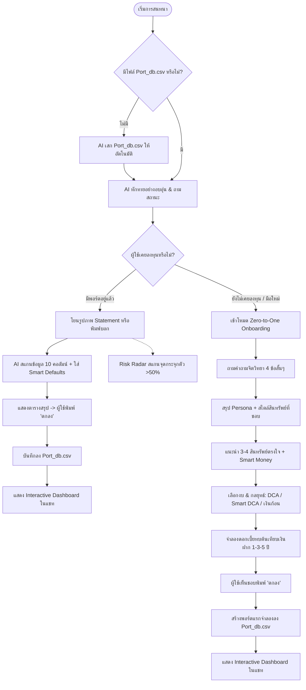

# 💼 Proactive Wealth Coach

> Copied into my-finance from https://github.com/Chinnakrit-jun/AI-Agent-for-invest (commit f0f150d). The skill itself is `.agents/skills/investment/SKILL.md`.

> **AI-Powered Autonomous Personal Wealth Copilot (SEA x OpenAI Hackathon)**  
> ผู้ช่วยบริหารพอร์ตการลงทุนอัจฉริยะ • ใช้งานง่ายไม่ต้องรู้เรื่องโค้ด • คุมความเสี่ยงตามแนวคิด Smart Money ระดับโลก • พร้อมระบบ Self-Bootstrapping จบในไฟล์เดียว

---

## 🌟 1. สิ่งที่ระบบนี้ทำได้ (Core Capabilities)

* **⚡ Self-Bootstrapping (เสกตัวเองได้จากศูนย์):**
  * แม้เปิดในโฟลเดอร์ว่างเปล่า AI จะตรวจจับและสร้างไฟล์ฐานข้อมูล `Port_db.csv` (10 คอลัมน์) ขึ้นมาเองอัตโนมัติเบื้องหลัง ไม่ต้องลงโปรแกรมหรือเตรียมไฟล์ไว้ล่วงหน้า
* **📸 Zero-Friction Vision OCR (สแกนสลิปพอร์ตจากภาพ):**
  * สแกน Statement จากแอปโบรกเกอร์ (Dime, InnovestX, Streaming) ดึง Ticker, จำนวนหุ้นทศนิยมเป๊ะ, ต้นทุน, กำไร/ขาดทุน ลงตาราง 10 คอลัมน์
  * มี **Smart Defaults** (ปันผลตั้ง 0 อัตโนมัติ, จำ Broker เดิม) ยืนยันเพียงคำว่า *"ตกลง"* ก็บันทึกทันที
* **🧭 Investor Persona Discovery (ค้นหาสไตล์การลงทุน 4 มิติ):**
  * ชวนคุยคำถามจิตวิทยาการเงินสั้นๆ 4 ข้อ (รับความเสี่ยง, ระยะเวลาถือครอง, เป้าหมายกระแสเงินสด, สไตล์สินทรัพย์ที่ชอบ)
  * จัดกลุ่มผู้ใช้เข้า 3 สไตล์:
    * 🌱 **สายเน้นปันผล (Dividend Lover):** เป้าหมาย ~7% ต่อปี ผันผวนต่ำ รับกระแสเงินสดทุกไตรมาส
    * ⚖️ **สายสมดุลชนะเงินฝาก (Balanced Investor):** เป้าหมาย ~8.5% ต่อปี กระจายความเสี่ยง ชนะเงินเฟ้อ ถือยาวหลับสบาย
    * 🚀 **สายเติบโตระยะยาว (Growth Seeker):** เป้าหมาย ~10.5% ต่อปี เน้นสะสมหุ้นเติบโตและเทคโนโลยีเพื่อเงินก้อนใหญ่
* **🌍 Open Universe & Curated Knowledge (สินทรัพย์หลากหลายระดับโลก):**
  * ไม่ผูกขาดเฉพาะ ETF แต่ครอบคลุมทั้ง:
    * 🏛️ **หุ้นเทคโนโลยีระดับโลก:** `AAPL`, `MSFT`, `NVDA`, `GOOGL`
    * 🥤 **ราชาปันผลกระแสเงินสดแกร่ง:** `KO` (โค้ก), `JNJ`, `PG`
    * 🏢 **อสังหาริมทรัพย์ปันผลรายเดือน (REITs):** `O` (Realty Income จ่ายปันผลสดเข้าบัญชีทุกเดือน!), `VNQ`
    * 🥇 **ทองคำแท้ป้องกันความเสี่ยง:** `IAU`, `GLD`
    * 🌐 **กองทุนดัชนีชั้นนำ:** `VOO`, `VT`, `SCHD`, `QQQ`, `XLV`, `XLP`, `CIBR`, `SMH`
  * เปิดรับหุ้นทุกตัวในโลก (ทั้งหุ้นไทยและต่างประเทศ)
* **🛡️ Risk Control & Smart Money Radar (ตรวจจับความเสี่ยง):**
  * สแกนจุดกระจุกตัว (>50% สินทรัพย์เดี่ยว, >60% อุตสาหกรรม) พร้อมดึงหลักคิดของ **Warren Buffett, Ray Dalio, John Bogle** มาช่วยเตือนสติเพื่อปรับพอร์ตอย่างมีเหตุผล
* **📈 Flexible Strategy & Compound Simulator (จำลองผลตอบแทนหลายกลยุทธ์):**
  * รองรับทั้ง **DCA ปกติ**, **Smart DCA (ช้อนซื้อช่วงตลาดย่อตัว เพิ่มผลตอบแทน ~1.2%)**, และ **Lump Sum (แบ่งไม้เงินก้อน)**
  * คำนวณดอกเบี้ยทบต้นเทียบให้เห็นชัดเจนว่า **ดีกว่าการฝากธนาคารกี่บาท และชนะเงินเฟ้อเท่าไหร่**
* **🎨 In-Chat Interactive Dashboard (แดชบอร์ดในแชท):**
  * เสกการ์ดสรุปพอร์ต, กราฟ Donut Chart สัดส่วน, ตารางผลตอบแทน พร้อมปุ่มกดสลับดูค่าเงิน **USD ($) / THB (฿)** ฝังในแชทได้สดๆ

---

## 🔄 2. ขั้นตอนการทำงานทั้งหมด (End-to-End Workflow)

---

## 🛠️ 3. สิ่งที่ต้องปรับปรุงและต่อยอดในอนาคต (Future Enhancements)

1. **🌐 Real-time Market Price & FX API:** เชื่อมต่อ API ดึงราคาหุ้นแบบเรียลไทม์และอัตราแลกเปลี่ยนค่าเงินบาท/ดอลลาร์สดๆ (เช่น Yahoo Finance API)
2. **📱 Multi-Broker Aggregator:** ระบบรวมพอร์ตหลายโบรกเกอร์ในหน้าเดียว (เช่น รวมพอร์ต Dime + InnovestX + พอร์ตคริปโต)
3. **📅 Dividend Calendar & Tax Optimization:** ปฏิทินแจ้งเตือนวันจ่ายเงินปันผลล่วงหน้า พร้อมคำนวณหักภาษี ณ ที่จ่าย (Withholding Tax 15% หุ้นสหรัฐฯ)
4. **⚡ Stress Test Simulator:** โปรแกรมจำลองวิกฤตเศรษฐกิจในอดีต (เช่น วิกฤตซับไพรม์ 2008 หรือโควิด 2020) ให้ผู้ใช้เห็นภาพความทนทานของพอร์ตก่อนเริ่มลงทุนจริง
5. คำตอบเกี่ยวกับการแนะนำการลงทุนอยากให้มีข้อมูลมารองรอบที่น่าเชื่อถือมารองรับ(เช่นเหตุผลในการแนะนำ %ปันผล หรือการเติบโต ควรมีข้อมูลที่น่าเชื่อถือกว่านี้)
6. อยากให้แนะนำสินทรัพย์การลงทุนที่หลากหลายกว่านี้ (ไอเดียคือการแนะนำพวกสินทรัพย์ที่ดีๆ เป็นตัวเลือกเลือกแรกๆแล้วถ้าผู้ใช้ไม่ชอบค่อยแนะนำเพิ่ม)
7. อยากให้มีการแนะนำสไตล์การลงทุนที่หลากหลายกว่านี้นอกจากการทำDCA อาจจะเป็นพวกสายลงทุนระยะสั้น
8. สามารถอ่านพฤติกรรมจาก pillar อื่นๆและเอามาช่วยแนะนำการลงทุน
9. ถ้าสมารถอ่านตลาดแล้วคาดการณ์ว่าจะเป็นยังไงได้จะดีมาก (ตัวอย่าง: https://github.com/danilobatson/ai-trading-agent-gemini)
---

## 🚀 วิธีเริ่มต้นใช้งาน (Quick Start)

1. นำไฟล์ [`skill.md`](skill.md) ไปวางในโฟลเดอร์ของโปรเจกต์
2. เปิดโปรเจกต์ผ่าน **Google Antigravity**
3. พิมพ์ทักทาย AI ในช่องแชท:
   > *"สวัสดีครับ เริ่มต้นใช้งานตาม `@skill.md` ได้เลย"*
4. ระบบจะทำการ Self-Bootstrap และพร้อมดูแลพอร์ตของคุณทันที!
